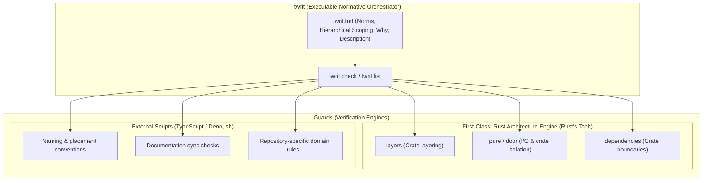

# `twrit`: Script Orchestration and "Why" Contextual Reporting

## Background & Context

`twrit` was originally conceived as the Rust equivalent of **ArchUnit** (Java), **Deptrac** (PHP), **Tach** (Python), and **dependency-cruiser** (JS/TS) — enforcing crate layering, module boundaries, and dependency invariants across Cargo workspaces.

However, as repositories grow, demand for inspection rules multiplies indefinitely:
- Architectural rules expand into naming conventions, file placement, documentation freshness, and git tracking constraints.
- Real-world repositories are polyglot (e.g., Rust + TypeScript + Nix + Web).

Attempting to implement every domain-specific or stylistic check inside `twrit`'s core Rust code would lead to bloat and domain contamination. Conversely:
- **`.writ.tmt` must NOT be a place to write scripts.** Embedding inline shell scripts would degrade `.writ.tmt` into a "Makefile wearing prose" with security and maintainability hazards.
- **Standalone shell scripts with `echo` lack normative power.** They cannot provide hierarchical scoping, discoverability (`twrit list`), auditability of unheld rules (`guard: { none: "..." }`), or standardized machine-readable context.

## Core Architectural Decision: Dual Responsibilities

`twrit` coexists as two complementary layers:

### 1. Built-in Core Engine (Rust's Tach / ArchUnit)
Heavy architectural checks requiring Cargo metadata, AST resolution, and transitive dependency analysis remain built into `twrit` (`guard: { twrit: layers | pure | door | dependencies }`).

### 2. Normative Orchestrator (Script Runner + Contextual "Why")
For repository-specific, multi-language, or stylistic rules:
- `twrit` delegates execution to external executables/scripts (e.g., `guard: { script: "scripts/check-kebab-naming.ts" }`).
- **Runtime responsibility belongs to the environment:** `twrit` only executes the specified binary. PATH resolution and toolchains (Deno, Python, Node, etc.) are managed by the repository's environment (Nix devshell / direnv / CI).
- **Contextual Reporting:** When a script fails (non-zero exit code), `twrit` captures its output and outputs a unified report pairing the failure with the rule's `why:` and `description:` metadata.

## Script Strategy & Sharing across Tomet Ecosystem

- **Repository-specific scripts:** Placed under each repository's `scripts/`.
- **Ecosystem-shared scripts:** Placed under `commonfiles/base/scripts/writ/` and distributed across repositories via `catasto`.
- **Primary Script Language:** **TypeScript (Deno)**
  - Single-file execution without `node_modules` or `package.json`.
  - Type-safe, fast startup, already included in `tomet` Nix devshell.
  - Permissions explicitly declared in shebang (`--allow-read`, `--allow-run`).
- **Lightweight Wrappers:** POSIX `sh` for simple 1-3 line CLI invocations.

## Implementation Tasks

- [ ] **1. Vocabulary update for script execution**
  - Define `guard: { script: "path" }` (or refine `runs:` semantics) in `writ.vocabulary.tmt`.
  - Specify working directory and argument conventions.
- [ ] **2. Script execution runner in `twrit-core`**
  - Execute target binary via `std::process::Command`.
  - Capture exit code, stdout, and stderr.
- [ ] **3. Formatted error reporting with `why`**
  - When a rule fails, print:
    - Rule ID and path
    - Failure output from the script
    - Rule `why:` explanation block
    - Optional remedial guidance
- [ ] **4. Audit & listing (`twrit list`)**
  - Display script-backed rules alongside built-in `twrit:` guards and `none:` items.
- [ ] **5. Test fixtures & verification**
  - Add integration tests with failing and passing script guards.
